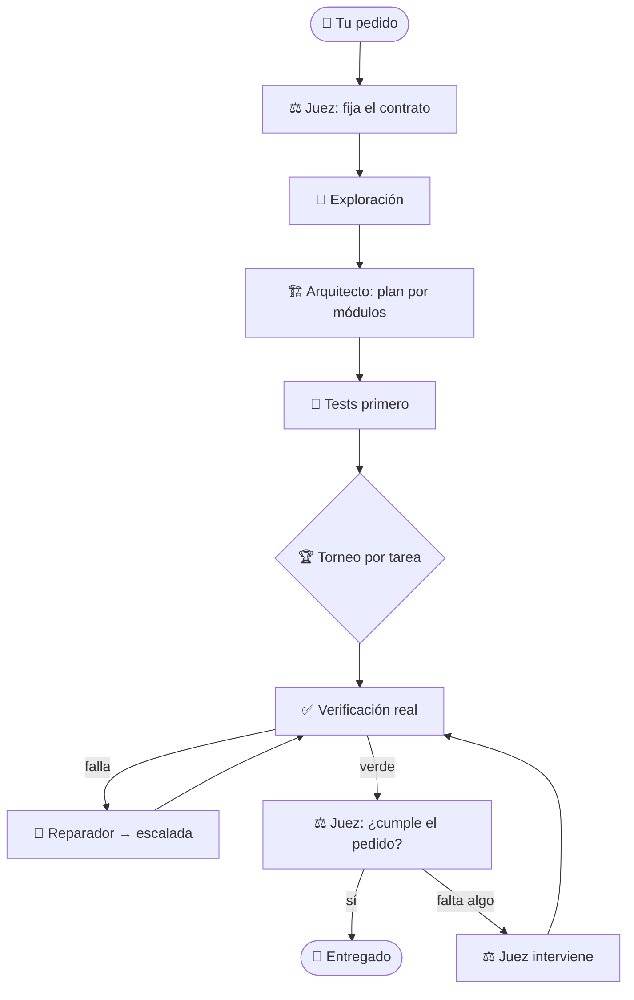

<div align="center">

```
█▀▀▄ █▀▀▀ ▄▀▀▄ █▀▀▄ █▀▀▀ █▀▀▄
█▄▄▀ █▄▄  █▄▄█ █▄▄▀ █▄▄  █▄▄▀
█  █ █▄▄▄ █  █ █    █▄▄▄ █  █
```

# 🐉 REAPER

### Agente de programación autónomo — en un solo archivo, en tu teléfono

*Lee, edita y ejecuta de verdad. Escribe tests, repara y **verifica** antes de decir que terminó.*
*Corre en Termux. Habla español. **No miente sobre lo que hizo.***

<br>


**[⬇️ Descargar](#instalacion) · [✨ Qué trae](#que-trae) · [🧠 Cómo piensa](#como-piensa) · [⚖️ El juez](#el-juez) · [🔎 Estado honesto](#estado)**

</div>

---

<a id="que-es"></a>

## ¿Qué es?

**REAPER** es un agente de programación que trabaja **dentro de un proyecto real**: no te tira un bloque de
código y se va — lee los archivos, los edita, corre comandos, escribe la suite de tests, repara lo que falla
y **verifica con pruebas reales** antes de dar algo por terminado. Está hecho para correr en un **teléfono con
Termux** (sin root, poca RAM) y para enrutar a **varios proveedores de modelos** —los que vos elijas,
gratuitos o de pago— en lugar de atarte a uno.

Su obsesión es la **honestidad**: no declara una build "verificada" sin tests reales en verde, no cuenta como
éxito una suite que en realidad se salteó, y un **juez de entrega** revisa al final que lo construido
**cumpla el pedido tal como se pidió**.

> [!NOTE]
> Proyecto **experimental**. El andamiaje está cubierto por **954 autotests**; la calidad del código que
> produzca depende del modelo que le conectes. Lee **[Estado honesto](#-estado)** antes de esperar magia.

---

<a id="vista"></a>

## 🖥️ Así se ve

```text
                █▀▀▄ █▀▀▀ ▄▀▀▄ █▀▀▄ █▀▀▀ █▀▀▄    █  █ ▀▀▀█
                █▄▄▀ █▄▄  █▄▄█ █▄▄▀ █▄▄  █▄▄▀    █  █   █
                █  █ █▄▄▄ █  █ █    █▄▄▄ █  █     ▀▀   █
                  agente autónomo de programación · 8.10

╭─ REAPER 8.10 ───────────────────────────────────────────────╮
│ ◆ proyecto  ~/mi-app                                        │
│ ▸ modelo    deepseek-chat · openrouter · modo auto-edición  │
│ ▸ equipo    6 roles + juez → 3 modelos / 2 prov             │
│ ▸ flujo     tests primero · torneo ×3 · escalada · juez     │
│ ▸ tests     pytest                                          │
╰─────────────────────────────────────────────────────────────╯
  ❯ construí una API de tareas con SQLite y tests
```

*Arranca con un dragón animado y trae **5 temas** de color (`dragon`, `oceano`, `matrix`, `clasico`, `mono`).*

---

<a id="que-trae"></a>

## ✨ Qué trae

| | |
|---|---|
| 🧩 **Un solo archivo** | `reaper_8.10_fusionado.py`: lo copiás y corre. Sin dependencias de paquetería. |
| 🤖 **Equipo de 8 agentes** | 6 roles + respaldo entre modelos + el **8.º: el juez de entrega**. |
| ⚖️ **Juez como motor central** | fija el contrato del pedido, vigila, juzga la entrega y **si falta algo, interviene**. Bajo costo. |
| 🧪 **Tests primero** | especificación ejecutable antes de implementar (cuando el proyecto lo amerita). |
| 🏆 **Torneo por tarea** | varios implementadores compiten en copias aisladas; gana el que pasa más tests. |
| 🧭 **Grafo de tareas** | ordena por dependencias y descompone proyectos grandes por módulo. |
| 🔁 **Reparación con escalada** | ante un fallo que se repite, sube a un modelo más fuerte. |
| 🔌 **Multi-proveedor** | ruteo por modelo a distintos endpoints/claves (OpenRouter, Groq, Gemini, NVIDIA…). |
| 🛡️ **Sin falsos verdes** | ✓ solo con `exit 0` y tests reales; **0 tests ≠ éxito**. |
| 🎨 **Linda en la terminal** | dragón, panel de estado, fases con acento y 5 temas de color. |

---

<a id="instalacion"></a>

## 🚀 Instalación

> [!TIP]
> En Termux alcanza con `pkg install python` y una clave de proveedor. Nada de root.

```bash
# 1) Descargá el archivo único
curl -fL -o reaper.py \
  https://raw.githubusercontent.com/celparaguayy-cloud/Reaper.py/ccr-6e025352-3tb6n4/entrega_fusion/reaper_8.10_fusionado.py

# 2) Configurá al menos una clave de proveedor (una sola vez)
export OPENROUTER_API_KEY=...        # o GROQ_API_KEY / GEMINI_API_KEY / NVIDIA_API_KEY ...

# 3) Corré
python3 reaper.py                    # modo interactivo
python3 reaper.py --autotest         # corre la batería de pruebas
python3 reaper.py --doctor           # chequeo del entorno
python3 reaper.py --instalar         # deja el comando `reaper` listo
```

Dentro, escribí en lenguaje natural o usá un comando:

```text
❯ construí una web con login y listado de productos
❯ /construir una API de tareas con SQLite y tests
❯ /validar          revisa tu config de modelos/equipo (sin tocar la red)
❯ /diagnostico      reporte para pegar si algo falla (nunca incluye tus claves)
❯ /equipo           los 8 agentes y a qué modelo apunta cada uno
❯ /ayuda            todos los comandos
```

---

<a id="como-piensa"></a>

## 🧠 Cómo piensa `/construir`



Cada paso deja evidencia real (tests, validadores, diff). El estado final lo decide **la verificación**, no
la opinión de un modelo: un "terminé" sin pruebas no alcanza.

---

<a id="el-juez"></a>

## ⚖️ El juez de entrega (el 8.º agente)

> Verifica que **la orden se haya hecho y se entregue tal como se pidió** — y si no, **interviene** para cerrarla.

- **Solo endurece.** Puede bajar una build de *verificada* a *parcial* si falta algo; **nunca** convierte una
  build roja en verde. Caza falsos éxitos, jamás los crea.
- **De bajo costo.** Es mayormente determinista (usa la evidencia que ya existe) y solo gasta tokens del modelo
  en los juicios que de verdad lo necesitan: el contrato al inicio y el veredicto final.
- **Siempre presente**, apagable con `/equipo juez off`, con su propio modelo vía `/modelo juez <alias>`.

El resto del equipo:

| # | Agente | Qué hace |
|:--:|---|---|
| 1 | 🧭 **Coordinador** | convierte tu pedido en una misión clara |
| 2 | 🏗️ **Arquitecto** | diseña el plan por módulos y dependencias |
| 3 | ⌨️ **Implementador** | escribe el código (en torneo, varios compiten) |
| 4 | 🔍 **Revisor** | busca bugs y riesgos en el diff |
| 5 | 🧪 **QA** | escribe y corre pruebas |
| 6 | 🔧 **Reparador** | arregla lo que falla y escala si hace falta |
| ⭐ | ⚖️ **Juez de entrega** | el control final: que se entregue tal como se pidió |

---

<a id="estado"></a>

## 🔎 Estado honesto

> [!IMPORTANT]
> Lo que **sí** está verificado y lo que **no**, sin maquillaje.

- ✅ **954 autotests OK** en Python **3.11, 3.12 y 3.13** (y en un Termux real con 3.14). Prueban la
  **orquestación** de forma determinista: ediciones y procesos reales, parseo de tests, gates de honestidad,
  Ctrl+C, plazos de pared, el juez. La red de modelos se simula con un **MockLLM**.
- ⚠️ **No verificado con modelos reales** en este repo (sin claves): la **calidad del código** depende del
  modelo que conectes. El andamiaje sube el piso; no inventa capacidad que el modelo no tenga.
- ⚠️ **Proyectos grandes**: el andamiaje de escala existe (mapa de relevantes, subagentes por tarea, grafo de
  dependencias, reanudación entre sesiones, compactación de contexto). Que salga **bien** depende del modelo.

**En una línea:** la máquina no te miente sobre lo que hizo; la calidad la pone el modelo.

---

<details>
<summary><b>🧱 Cómo está hecho (arquitectura)</b></summary>

<br>

REAPER se escribe en piezas (`partes/NN_*.py`) y se **empaqueta** en un único archivo de un solo espacio de nombres:

```bash
python3 empaquetar.py        # partes/*.py  →  reaper_v8.py  (130 partes)
python3 reaper_v8.py --autotest
# filtrar una clase de tests:
REAPER_AUTOTEST=juez python3 reaper_v8.py --autotest
```

Fácil de leer y mantener por módulos; se distribuye como **un archivo** que corre en cualquier lado.

</details>

<details>
<summary><b>🧰 Comandos (hay 64; muestra)</b></summary>

<br>

| Comando | Qué hace |
|---|---|
| `/construir <pedido>` | explora → planifica → tests → torneo → verifica → repara → juez |
| `/plan <pedido>` | solo exploración + plan (se guarda en `.reaper/planes`) |
| `/continuar` · `/pendiente` | reanuda una build grande entre sesiones |
| `/equipo` · `/equipo probar` | ruteo de los 8 agentes · prueba real de conectividad |
| `/modelo` · `/modelo elegir` · `/modelo buscar <t>` | modelo principal/por rol · selector · búsqueda |
| `/validar` · `/diagnostico` | valida la config · reporte redactado (sin claves) |
| `/tema <nombre>` | cambia la paleta de colores |
| `/deshacer` · `/diff` | revierte la última build · ve los cambios |
| `/ayuda` · `/manual` | todos los comandos · guía de uso |

</details>

<details>
<summary><b>🤝 Reglas que se mantienen entre versiones</b></summary>

<br>

- No declarar éxito sin evidencia ejecutada.
- No modificar tests para ocultar defectos.
- Los mocks **nunca** como única evidencia de que algo funciona.
- No aflojar permisos ni autorizaciones.
- **Claves solo por entorno** — nunca en el repo, los logs o los diagnósticos.

</details>

<div align="center">
<br>

**Hecho para programar desde el teléfono, con honestidad.** 🐉

</div>
