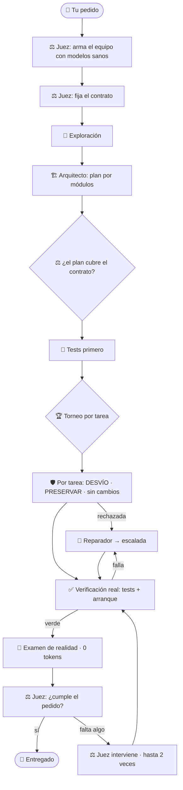

<div align="center">

```
█▀▀▄ █▀▀▀ ▄▀▀▄ █▀▀▄ █▀▀▀ █▀▀▄
█▄▄▀ █▄▄  █▄▄█ █▄▄▀ █▄▄  █▄▄▀
█  █ █▄▄▄ █  █ █    █▄▄▄ █  █
```

# 🐉 REAPER

### Agente de programación autónomo — en un solo archivo, en tu teléfono

*Lee, edita y ejecuta de verdad. Escribe tests, repara y **verifica** antes de decir que terminó.*
*Corre en Termux. Habla español. **No miente sobre lo que hizo.***

<br>


**[⬇️ Instalar](#instalacion) · [🛠️ De cero a construir](#de-cero) · [⚖️ El juez](#el-juez) · [🧠 Cómo piensa](#como-piensa) · [🆕 Novedades](#novedades) · [🔎 Estado honesto](#estado)**

</div>

---

<a id="que-es"></a>

## ¿Qué es?

**REAPER** es un agente de programación que trabaja **dentro de un proyecto real**: no te tira un bloque de
código y se va. Lee los archivos, los edita, corre comandos, escribe la suite de tests, repara lo que falla
y **verifica con pruebas reales** antes de dar algo por terminado. Está hecho para correr en un **teléfono con
Termux** (sin root, poca RAM) y para enrutar a **varios proveedores de modelos** —los que vos elijas,
gratuitos o de pago— en lugar de atarte a uno.

Su obsesión es la **honestidad**: no declara una build "verificada" sin tests reales en verde, no cuenta como
éxito una suite que en realidad se salteó, y un **juez** maneja la construcción de punta a punta para que
lo entregado **sea lo que pediste, funcione de verdad y no rompa lo que ya tenías**.

> [!NOTE]
> Proyecto **experimental**. El andamiaje está cubierto por **1239 autotests**; la calidad del código que
> produzca depende del modelo que le conectes. Lee **[Estado honesto](#estado)** antes de esperar magia.

---

<a id="vista"></a>

## 🖥️ Así se ve

```text
                █▀▀▄ █▀▀▀ ▄▀▀▄ █▀▀▄ █▀▀▀ █▀▀▄    █  █ ▀▀▀█
                █▄▄▀ █▄▄  █▄▄█ █▄▄▀ █▄▄  █▄▄▀    █  █   █
                █  █ █▄▄▄ █  █ █    █▄▄▄ █  █     ▀▀   █
                  agente autónomo de programación · 8.10

╭─ REAPER 8.10 ───────────────────────────────────────────────╮
│ ◆ proyecto  ~/mi-app                                        │
│ ▸ modelo    deepseek-chat · openrouter · modo auto-edición  │
│ ▸ equipo    6 roles + juez → 3 modelos / 2 prov             │
│ ▸ flujo     tests primero · torneo ×3 · escalada · juez     │
│ ▸ tests     pytest                                          │
╰─────────────────────────────────────────────────────────────╯
  ❯ construí una API de tareas con SQLite y tests
```

*Arranca con un dragón animado y trae **5 temas** de color (`dragon`, `oceano`, `matrix`, `clasico`, `mono`).*

---

<a id="que-trae"></a>

## ✨ Qué trae

| | |
|---|---|
| 🧩 **Un solo archivo** | `reaper_8.10_fusionado.py`: lo copiás y corre. Sin dependencias de paquetería. |
| ⚖️ **Juez como motor central** | arma el equipo, fija el contrato, vigila cada tarea, juzga la entrega e **interviene** si falta algo. |
| 💸 **El que más hace, el que menos gasta** | casi todo su control es determinista (**0 tokens**); el cierre te muestra cuánto gastó. |
| 🚀 **Arranca de verdad** | además de los tests, ejecuta el punto de entrada: si el programa no arranca, **no es verde**. |
| 🔬 **Examen de realidad** | detecta funciones vacías, `NotImplementedError`, **datos inventados** (p. ej. un número con `random`) y comentarios que confiesan ser provisionales: **una simulación no se entrega**. |
| 🛡️ **Protege tu trabajo previo** | agregar está bien; borrar o vaciar archivos que ya tenías sin que se pidiera **se rechaza**. |
| 🎯 **Sin desvíos** | si una tarea toca archivos que no le tocaban (en lugar del pedido), se marca DESVÍO y se repara. |
| 🤖 **Equipo de 8 agentes** | 6 roles + respaldo entre modelos + el **8.º: el juez**. |
| 🧪 **Tests primero** | especificación ejecutable antes de implementar (cuando el proyecto lo amerita). |
| 🏆 **Torneo por tarea** | varios implementadores compiten en copias aisladas; gana el que pasa más tests. |
| 🏗️ **Proyectos grandes por etapas** | `/grande`: plan maestro en etapas; cada una es un `/construir` verificado, nada se construye sobre una etapa rota, se retoma donde quedó y cierra con una integración contra tu pedido original. |
| 🧭 **Grafo de tareas** | ordena por dependencias y descompone cada build por módulo (hasta 60 tareas). |
| 🔁 **Reparación con escalada** | ante un fallo que se repite, sube a un modelo más fuerte. |
| 🔌 **Multi-proveedor** | ruteo por modelo a distintos endpoints/claves (OpenRouter, Groq, Gemini, NVIDIA…). |
| ✅ **Sin falsos verdes** | ✓ solo con `exit 0` y tests reales; **0 tests ≠ éxito**; "tests pasan" con 0 cambios ≠ hecho. |
| 🎨 **Linda en la terminal** | dragón, panel de estado, fases con acento, cierre en caja y 5 temas de color. |

---

<a id="instalacion"></a>

## 🚀 Instalación

> [!TIP]
> En Termux alcanza con `pkg install python` y una clave de proveedor. Nada de root.

```bash
# 1) Dependencias de Termux (una vez)
pkg update -y && pkg install -y python git

# 2) Descargá el archivo único
curl -fL -o ~/reaper_nuevo.py \
  https://raw.githubusercontent.com/celparaguayy-cloud/Reaper.py/ccr-6e025352-3tb6n4/entrega_fusion/reaper_8.10_fusionado.py

# 3) Verificá que bajó entero (compará con entrega_fusion/REAPER_FUSION_SHA256.txt)
sha256sum ~/reaper_nuevo.py

# 4) Clave de proveedor: guardala en un archivo propio (sobrevive al reinicio de Termux)
mkdir -p ~/reaper && printf '%s' 'TU_CLAVE' > ~/reaper/.clave_openrouter && chmod 600 ~/reaper/.clave_openrouter
#    (alternativa: export OPENROUTER_API_KEY=...  · también GROQ_API_KEY / GEMINI_API_KEY / NVIDIA_API_KEY)

# 5) Chequeo e instalación del comando `reaper`
python3 ~/reaper_nuevo.py --doctor
python3 ~/reaper_nuevo.py --instalar
```

> [!IMPORTANT]
> **Actualizar no borra tu configuración.** Tu config, claves, sesiones, checkpoints y memoria viven en
> `~/reaper/` y `--instalar` solo reemplaza `~/reaper/app/reaper.py` **después de compilar la versión nueva**
> (si la nueva no compila, la que funciona queda intacta). Igual, un respaldo nunca está de más:
>
> ```bash
> cp -r ~/reaper ~/reaper_respaldo_$(date +%Y%m%d)
> ```
>
> ¿Querés probar sin tocar nada tuyo? Usá una carpeta aparte: `REAPER_HOME=~/reaper_prueba reaper`.

---

<a id="de-cero"></a>

## 🛠️ De cero a construir con el juez

**Paso 1 · Revisá la configuración (sin gastar tokens)**

```text
$ reaper --proyecto ~/mi_app
❯ /validar            ¿la config de modelos/equipo tiene sentido? (no toca la red)
❯ /proveedores        qué proveedores tienen clave (nunca muestra la clave)
❯ /equipo             los 8 agentes y a qué modelo apunta cada uno
```

**Paso 2 · Elegí tus modelos (vos decidís; el juez solo reemplaza los que estén caídos)**

```text
❯ /modelo elegir                  selector interactivo del modelo principal
❯ /modelo buscar coder            busca por nombre
❯ /modelo implementador <alias>   modelo para un rol concreto
❯ /modelo juez <alias>            modelo del juez (conviene uno chico y barato)
❯ /equipo probar                  prueba REAL de que cada modelo responde
```

**Paso 3 · Encendé el juez y mirá cómo armaría el equipo**

```text
❯ /equipo juez on     queda ON (viene ON por defecto)
❯ /equipo juez        estado + qué roles reasignaría en la próxima build y por qué
```

**Prueba grande en UN comando (Termux)**: baja y verifica la última versión, la instala, muestra tu cupo, construye
un almacén completo por etapas (o lo retoma si ya había empezado) y deja el ZIP de `/reporte` en Descargas:

```bash
curl -fsSL -o ~/probar_grande.sh https://raw.githubusercontent.com/celparaguayy-cloud/Reaper.py/ccr-6e025352-3tb6n4/pruebas_fusion/probar_grande.sh
bash ~/probar_grande.sh
```

**Paso 4 · Proyectos grandes: por etapas (opcional)**

Si el proyecto no entra en un solo plan (backend + base de datos + web + reportes…), usá `/grande`: arma un plan
maestro por etapas y construye una por vez, verificando cada una.

```text
❯ /grande un sistema para un almacén: stock, ventas, clientes, reportes, API JSON y una web para el celular
❯ /grande estado                  qué etapas están verificadas y por qué paró la última
❯ /grande continuar               sigue donde quedó (aunque se haya cortado a mitad)
❯ /grande deshacer                vuelve al último estado verificado si una etapa rompió algo
❯ /reporte                        ZIP sin claves para mandar cuando algo sale mal
❯ /config max_etapas 15           tope de etapas (2 a 30); cada etapa hasta max_tareas tareas
❯ /config max_tareas 30           tope de tareas por build (máx. 60)
```

> [!TIP]
> **¿Se cortó?** (Termux cerrado, pantalla bloqueada, límite del modelo gratis) Repetí **el mismo comando**: REAPER
> retoma donde quedó, sin empezar de cero, aunque se haya cortado a mitad de una etapa. También: `reaper --proyecto
> ~/mi_app --grande continuar` (o `--construir continuar`; si empezaste con `--perfil gratis`, agregalo: REAPER te
> muestra el comando exacto) y `--grande estado`. Para que Android no lo corte: `termux-wake-lock` antes de empezar.

**Paso 5 · Construí**

```text
❯ /construir una API de tareas con FastAPI, SQLite, tests y un CLI que arranque con python -m tareas
```

o sin entrar al modo interactivo:

```bash
reaper --proyecto ~/mi_app --construir "una API de tareas con FastAPI, SQLite, tests y un CLI"
reaper --proyecto ~/mi_app --plan "una API de tareas..."   # solo el plan, sin tocar archivos
```

**Paso 6 · Leé el cierre y decidí**

```text
❯ /diff               qué cambió exactamente
❯ /deshacer           revierte la build entera (checkpoint)
❯ /continuar          retoma lo que quedó pendiente (también entre sesiones)
❯ /diagnostico        reporte para pegar si algo falla (las claves salen redactadas)
```

Qué vas a ver en pantalla durante la build:

```text
  Juez · arma el equipo según la necesidad:
    • implementador: modelo-a → modelo-b (modelo-a no responde)
  Juez · contrato de entrega (lo que hay que cumplir):
    • el CLI arranca con python -m tareas
    • endpoints de crear/listar/borrar tareas con tests
  Juez · el plan todavía no parece cubrir: el CLI arranca con python -m tareas
  ...
╭─ ✓ BUILD VERIFICADA
│ validadores + tests reales
│ 6m12s · 7 archivo(s) · +418 −12 · 2 torneo(s) · 9 tests previos
│ ⚖ juez: ~1.9k tokens (2.3% de la build)
╰─
```

<sub>Ilustrativo: los modelos, archivos y números cambian en cada build. Si el juez encuentra faltantes, el
cierre dice **BUILD PARCIAL** y muestra `juez: no cumple el pedido → …`. Si decidió solo con evidencia local,
dice `⚖ juez: 0 tokens · decidió con evidencia local`.</sub>

---

<a id="el-juez"></a>

## ⚖️ El juez (el 8.º agente, motor central)

> Se hace cargo de la build de punta a punta: que se construya **exactamente lo pedido**, que **funcione de
> verdad** y que **no rompa lo que ya tenías**. Y es el que menos gasta.

| Momento | Qué hace el juez | Costo |
|---|---|:--:|
| **Antes de empezar** | arma el equipo: si el modelo de un rol está caído o rinde mal, lo cambia por uno sano (prioriza modelos fuertes en los roles críticos). Al terminar **restaura tu asignación**. | 0 tokens |
| **Contrato** | convierte tu pedido en criterios de entrega verificables, que **gobiernan el plan**. | 1 consulta corta |
| **Vigía del plan** | avisa si el plan no cubre algún criterio del contrato. | 0 tokens |
| **Cada tarea** | DESVÍO (tocó otro archivo en vez del pedido) y PRESERVAR (borró o reescribió trabajo previo) → la tarea **se rechaza y se repara**. | 0 tokens |
| **Verificación** | además de los tests, ejecuta el punto de entrada: `ModuleNotFoundError`, `SyntaxError`… = **no arranca = no es verde**. | 0 tokens |
| **Examen de realidad** | funciones vacías, `NotImplementedError`, tests sin aserciones: **veredicto determinista**, no se le pregunta a ningún modelo. | 0 tokens |
| **Veredicto** | compara lo entregado contra el contrato con evidencia (estado, diffstat, preservación, realidad). | 1 consulta corta |
| **Cierre** | si falta algo, **interviene** (hasta 2 veces): manda a reparar con escalada y vuelve a verificar. | solo si hace falta |

**Reglas que no se negocian:**

- **Solo endurece.** Puede bajar una build de *verificada* a *parcial*; **nunca** convierte una roja en verde.
  Caza falsos éxitos, jamás los crea.
- **Si la evidencia dice rojo, es rojo.** Aunque el modelo del juez opine "cumple", un estado rojo fuerza `cumple=false`.
- **Cuentas a la vista.** El cierre muestra cuántos tokens gastó el juez y qué porcentaje de la build fue.
- **Apagable** con `/equipo juez off`; su propio modelo con `/modelo juez <alias>`.

El resto del equipo:

| # | Agente | Qué hace |
|:--:|---|---|
| 1 | 🧭 **Coordinador** | convierte tu pedido en una misión clara |
| 2 | 🏗️ **Arquitecto** | diseña el plan por módulos y dependencias |
| 3 | ⌨️ **Implementador** | escribe el código (en torneo, varios compiten) |
| 4 | 🔍 **Revisor** | busca bugs y riesgos en el diff |
| 5 | 🧪 **QA** | escribe y corre pruebas |
| 6 | 🔧 **Reparador** | arregla lo que falla y escala si hace falta |
| ⭐ | ⚖️ **Juez** | arma el equipo, fija el contrato, vigila, juzga e interviene |

---

<a id="como-piensa"></a>

## 🧠 Cómo piensa `/construir`



Cada paso deja evidencia real (tests, arranque, validadores, diff). El estado final lo decide **la
verificación**, no la opinión de un modelo: un "terminé" sin pruebas no alcanza.

---

<a id="novedades"></a>

## 🆕 Novedades

**Proyectos grandes: `/grande` (o `reaper --grande "..."`)**

- 🏗️ Un plan maestro divide el pedido en **etapas** (archivos, interfaz que deja para las siguientes, criterios) y
  cada etapa se construye con un `/construir` completo: tests, juez, preservación, examen de realidad, arranque.
- 🧱 Si una etapa no queda verificada se retoma una vez y, si sigue mal, **se frena**: no se construye encima de
  algo roto. `/grande continuar` sigue donde quedó (aunque se haya cortado a mitad de una etapa).
- 🧩 Al final, **integración**: verificación real de todo el proyecto y el juez contra **tu pedido original**; si
  falta algo, una build acotada lo completa.
- ⏯️ **Si se corta, repetí el mismo comando y sigue donde quedó** (antes respondía "ya hay una build incompleta").
  `--grande continuar` / `--construir continuar` desde la terminal, y el comando exacto aparece al cortarse.
- 🆓 **Preparado para modelos gratis reales**: detecta el cupo DIARIO de OpenRouter agotado (50 pedidos por día sin
  crédito, 1000 con crédito) y se detiene limpio diciendo a qué hora se renueva; antes de arrancar estima los
  pedidos y te dice cuántos te quedan; ante límites pasajeros espera solo y sigue.
- ↩️ `/grande deshacer`: si una etapa rompe algo de una etapa anterior, REAPER te lo dice y volvés al último estado
  verificado con un comando.
- 📦 `/reporte` (o `reaper --reporte`): un ZIP sin claves con informes, estado, logs y código para mandar y mejorar.
- ⚠️ Probado de punta a punta con un modelo **simulado** que escribe código real (un almacén en 5 etapas con API HTTP
  y web, y una biblioteca en 3); **todavía no con un modelo real** (ver Estado honesto).

**Probado con un modelo REAL (OpenRouter, modelos gratis, $0)**

- 🆓 El perfil `gratis` elige de los modelos gratis que OpenRouter ofrece **hoy** (antes apuntaba a uno retirado).
- ⏩ Si un modelo gratis está saturado (429), pasa enseguida al siguiente en vez de esperar ~35 s.
- 🧠 Los modelos "que piensan" ya no se quedan sin respuesta en los pedidos cortos del juez.
- 🚫 El plan ya no puede ordenar **esqueletos ni `NotImplementedError`**: el juez lo hace replanificar, y las
  tareas de "solo correr los tests" (que terminaban creando archivos fantasma) se quitan.
- 🔓 Una tarea cuyo trabajo ya hizo otra ya no queda en un bucle de reparaciones sin salida ni bloquea al resto.
- 🧪 Si un test de la especificación pasa **sin que exista el código**, se manda a corregir: no prueba nada.

**Reparado con una corrida real que falló en Termux**

- 🩹 `/diagnostico <archivo>` ya no puede pisar tu código (antes `/diagnostico app.py` lo reemplazaba por el reporte).
- 💥 Un proceso matado por el sistema (**señal 9**, típico al compilar grpcio en el teléfono) ahora se explica, con
  pistas para no repetir la misma instalación.
- 🔁 Si pedís "reescribí X desde cero" (o aprobás un plan que avisa que reemplaza archivos), se respeta; si no,
  PRESERVAR protege y, si la tarea falla, **restaura** lo que había.
- 🧾 El informe de cada build guarda la versión de REAPER, el **motivo real** de cada tarea fallida y lo que hizo el juez.

**Construcción fiel (el juez maneja el proyecto)**

- 🎯 **DESVÍO por tarea**: si la tarea pedía `tareas/cli.py` y el cambio fue a otro archivo, se rechaza.
- 🛡️ **PRESERVAR**: protege los archivos que existían antes de la build. Se rechaza borrar uno que la
  tarea no pedía, quitarle una parte (≥20 %) sin pedirlo o reescribir casi entero (≥60 %) uno que sí pedía.
  Agregar y las ediciones chicas pasan: las actualizaciones no pisan tu trabajo anterior.
- 🚀 **Verificación de arranque**: detecta `python -m paquete`, `if __name__ == "__main__"` y CLIs, los
  ejecuta y exige que arranquen.
- 🔬 **Examen de realidad (0 tokens)**: funciones vacías, `NotImplementedError` y tests sin valor bloquean
  la entrega sin consultar a ningún modelo.
- 🤝 **El juez arma el equipo**: reemplaza modelos caídos o con mal historial por roles, y restaura tu
  configuración al terminar.
- 💸 **Cuenta de tokens del juez** en el cierre.
- 🧰 `/validar`, `/diagnostico`, `/modelo elegir|buscar`, `/equipo juez on|off` con vista previa del equipo.

---

<a id="estado"></a>

## 🔎 Estado honesto

> [!IMPORTANT]
> Lo que **sí** está verificado y lo que **no**, sin maquillaje.

- ✅ **1239 autotests OK** en Python **3.10, 3.11, 3.12 y 3.13** (y en un Termux real con 3.14 en una versión
  anterior). Prueban la **orquestación** de forma determinista: ediciones y procesos reales, parseo de tests,
  gates de honestidad, Ctrl+C, plazos de pared y el juez (contrato, cierre, desvío, preservación, arranque,
  examen de realidad, armado del equipo). La red de modelos se simula con un **MockLLM**.
- ✅ **Corridas de punta a punta** de la CLI real contra un **OpenRouter simulado por HTTP** (`pruebas_fusion/e2e/`):
  el script del teléfono entero, `/grande` de 5 etapas con el pipeline completo, cupo diario agotado a mitad de
  etapa y retomado "al otro día", Ctrl+C en 8 momentos distintos, modelos que solo razonan, 429 por minuto y un
  implementador flojo. Encontraron 8 bugs de lógica (p. ej. una etapa cortada por el cupo no se podía retomar
  nunca más) y 10 fallas de mensajes, todos corregidos con su test.
- ✅ **Simulador de modelo gratis flojo** (`pruebas_fusion/e2e/caos.sh`): las fallas reales del teléfono (modelos
  que piensan sin responder, 500, vacías, límites por minuto, herramientas mal escritas, acciones anunciadas sin
  hacerlas). Con caos fuerte, el almacén de 5 etapas pasó de **2/3 a 3/3 terminadas, con 35 % menos pedidos**. La
  falla de la tercera prueba real (tests acoplados a la implementación) reproducida: antes etapa 2 FALLIDA, ahora
  5/5, incluso retomando el proyecto que dejó trabado la versión vieja. Es un simulador: **no reemplaza a un
  modelo real**.
- ✅ **Probado como en un Termux recién instalado** (solo Python y git, sin `node`, `ruff` ni `pytest`): la suite
  completa pasa, y apareció un falso verde que ya está corregido. Sin `node`, la etapa de la web quedaba "verificada"
  sin haber corrido nunca sus tests de JavaScript. Ahora REAPER avisa al empezar y frena esa etapa sin gastar pedidos
  (`pkg install nodejs` y `/grande continuar`). Con una cuenta de **50 pedidos gratis por día**, el almacén de 5 etapas
  del simulador usa **46**: entra en un día.
- ✅ **Probado con un modelo real** (OpenRouter, `nemotron-3-super` gratis): la primera build completa terminó
  **✓ VERIFICADA** (15 tests reales; el juez dijo CUMPLE gastando el 0,5 % de la build) y el código funciona
  (verificado aparte). Un proyecto más grande (gestor de gastos: SQLite, CSV, CLI con 6 subcomandos, 622 líneas)
  también terminó **✓ VERIFICADA**. Las pruebas reales encontraron **10 bugs de REAPER** (y 2 fallos en mis propios
  arreglos), todos corregidos con su test. Una revisión posterior **sin API** encontró 5 huecos más (p. ej.
  en proyectos con tests de Python y JS, los de JS nunca corrían) y 3 fallos más de mis arreglos (el examen de
  realidad marcaba comentarios legítimos como simulación). Ver `entrega_fusion/REAPER_FUSION_PRUEBAS.md` §18.
- ⚠️ **"Verificada" no es "perfecta"**: significa que pasa los tests que existen y el contrato del juez. En el
  gestor de gastos quedó un error de lógica que ningún test cubría (el presupuesto mensual sumaba otros meses).
  Cuanto más explícito sea tu pedido, más lo cubren el contrato y los tests.
- ⚠️ **Cupo de los modelos gratis de OpenRouter**: 50 pedidos por día si nunca compraste crédito (1000 con al menos
  10 de crédito). Un proyecto grande necesita cientos: con 50/día avanza por tramos (REAPER se detiene limpio, dice
  a qué hora se renueva y sigue con `--grande continuar`). `/doctor` te muestra cuántos te quedan hoy.
- ⚠️ **Los modelos gratis son inestables**: el día de la prueba la mayoría daba 429/503/403. REAPER los esquiva,
  pero una build puede tardar o no completarse. La **calidad del código** depende del modelo que conectes; el
  andamiaje sube el piso, no inventa capacidad que el modelo no tenga.
- ⚠️ **Proyectos grandes**: `/grande` los parte en etapas verificadas, retoma donde quedó y no construye sobre
  una etapa rota. Está probado con un modelo **simulado** que escribe código real (también por HTTP, de punta a
  punta); en las **pruebas con modelos reales** en un teléfono, la tercera ya verificó la etapa 1 de 6 y se
  detuvo en la 2. Cada una mostró bugs de REAPER, ya corregidos (`entrega_fusion/REAPER_FUSION_PRUEBAS.md` §21–§23):
  p. ej. un test de la especificación roto que REAPER protegió y que el reparador "arregló" con una trampa. **Todavía no terminó un `/grande` con un modelo
  real**: la calidad de cada etapa sigue dependiendo del modelo. Con modelos gratis, contá con muchas
  llamadas (cada etapa es una build entera) y con que los límites de uso pueden cortar a mitad: por eso
  existe `/grande continuar`.
- ⚠️ **Lo que el juez no puede hacer**: no convierte un modelo débil en uno fuerte. Lo que sí garantiza es que
  un resultado incompleto, simulado o que no arranca **no se te entregue como terminado**.

**En una línea:** la máquina no te miente sobre lo que hizo; la calidad la pone el modelo.

---

<details>
<summary><b>🧱 Cómo está hecho (arquitectura)</b></summary>

<br>

REAPER se escribe en piezas (`partes/NN_*.py`) y se **empaqueta** en un único archivo de un solo espacio de nombres:

```bash
python3 empaquetar.py        # partes/*.py  →  reaper_v8.py  (130 partes)
python3 reaper_v8.py --autotest
# filtrar una clase de tests:
REAPER_AUTOTEST=juez python3 reaper_v8.py --autotest
```

Fácil de leer y mantener por módulos; se distribuye como **un archivo** que corre en cualquier lado.

</details>

<details>
<summary><b>🧰 Comandos (hay 82; muestra)</b></summary>

<br>

| Comando | Qué hace |
|---|---|
| `/construir <pedido>` | equipo → contrato → plan → tests → torneo → verifica (tests + arranque) → realidad → juez |
| `/grande <pedido>` · `estado` · `continuar` | proyecto grande: plan maestro por etapas, un `/construir` verificado por etapa, integración final |
| `/plan <pedido>` | solo exploración + plan (se guarda en `.reaper/planes`) |
| `/continuar` · `/pendiente` | reanuda una build grande entre sesiones |
| `/equipo` · `/equipo probar` | ruteo de los 8 agentes · prueba real de conectividad |
| `/equipo juez [on\|off]` | estado del juez y cómo armaría el equipo |
| `/modelo` · `/modelo elegir` · `/modelo buscar <t>` | modelo principal/por rol · selector · búsqueda |
| `/modelo juez <alias>` | modelo propio del juez |
| `/validar` · `/diagnostico` | valida la config · reporte redactado (sin claves) |
| `/proveedores` | qué proveedores tienen clave (sin mostrarla) |
| `/config <clave> <valor>` | ajustes (`max_tareas`, `juez_max_intervenciones`, `verificar_arranque`…) |
| `/tema <nombre>` | cambia la paleta de colores |
| `/deshacer` · `/diff` | revierte la última build · ve los cambios |
| `/ayuda` | todos los comandos |

Flags de línea de comandos: `--proyecto`, `--construir`, `--plan`, `--modelo`, `--modelo-fuerte`,
`--perfil {gratis,rapido,equilibrado,maximo}`, `--modo {confirmar,auto-edicion,auto}`, `--doctor`,
`--instalar`, `--autotest`, `--version` (todos en `reaper --help`).

</details>

<details>
<summary><b>🤝 Reglas que se mantienen entre versiones</b></summary>

<br>

- No declarar éxito sin evidencia ejecutada.
- No modificar tests para ocultar defectos.
- Los mocks **nunca** como única evidencia de que algo funciona.
- No aflojar permisos ni autorizaciones.
- No pisar el trabajo previo del usuario sin que se pida.
- **Claves solo por entorno o en `~/reaper/.clave_<proveedor>`**: nunca en el repo, los logs ni los diagnósticos.

</details>

<div align="center">
<br>

**Hecho para programar desde el teléfono, con honestidad.** 🐉

</div>
